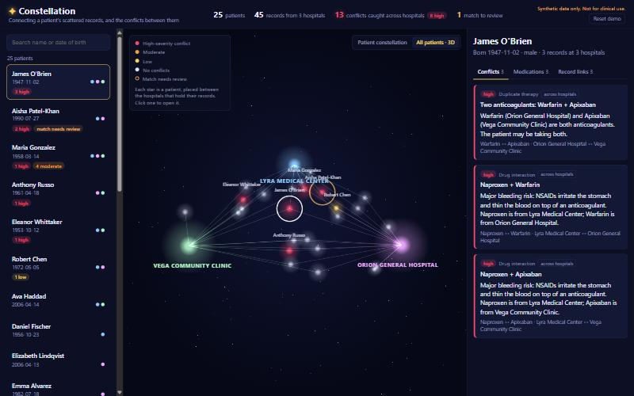

# ✦ Constellation

**Hospitals can already share patient records. Nobody connects the dots.**
Constellation gathers one patient's scattered records from different hospitals into a single
constellation, and flags the dangerous contradictions between them before they cause harm.

*Built at Hyphen-Hacks 2026 for the theme "Crafting Constellations".*

**Try it:** [live demo](https://johnha749-creator.github.io/constellation/) (read-only, no sign-in) · [pitch deck](https://johnha749-creator.github.io/constellation/pitch.html)
<!-- Team: add your names here before submitting. -->


> All patients and hospitals are made up. This is a hackathon prototype, not a medical device.

## The problem

When a patient is treated at several hospitals, each one keeps its own record. National networks
such as TEFCA, Epic's network and CommonWell can now send those records between hospitals, but
two problems remain:

1. **The same person looks different in each system.** "Jim OBrien" at one hospital is
   "James O'Brien" at another, with the birth date typed day-first. If the records aren't linked,
   nobody sees the full picture.
2. **Nobody cross-checks the pile.** One hospital records a penicillin allergy. Another hospital's
   ER, without seeing it, prescribes amoxicillin, which is a penicillin.

## What Constellation does

1. **Reads each hospital's records** in **FHIR R4**, the standard format hospitals use to exchange
   data.
2. **Works out which records belong to the same person**, even with nicknames, typos, swapped
   dates, married names or a move. Every link comes with a confidence score and a plain-English
   reason.
3. **Puts a human in charge of uncertain matches.** A link scored between 50% and 95% is flagged
   "needs review". A clinician clicks **Same person** or **Different people**, and the
   constellation re-forms. Every decision goes into a **tamper-evident audit trail**: who
   decided, when, and what the score was.
4. **Protects privacy by design:** clinicians sign in, contact details stay masked until there's
   a logged reason, every access is recorded, and records can be matched on encrypted
   fingerprints instead of names (see [Privacy and HIPAA](#privacy-and-hipaa)).
5. **Catches conflicts across the combined record:**
   - allergy vs drug
   - two drugs that do the same job
   - dangerous drug pairs
   - a drug that worsens a diagnosis
   - the same drug at different doses

   Each conflict says how serious it is and which hospital each side came from.
6. **Compiles one chart per patient.** The **Summary** tab puts every hospital's allergies,
   conditions and medications in one list, with the hospital each item came from. Items that
   only one hospital knew about are tagged: Maria's penicillin allergy is only in Orion's
   records, and every one of her 10 allergies, conditions and medications is known to just one
   hospital. Items from a match that still needs review are tagged too.
7. **Lists what the patient is actually taking:** every drug, every hospital that prescribed it,
   and its problems.
8. **Connects a new hospital while running.** Upload its FHIR bundle and Constellation checks
   the whole file first, rejecting it with a plain-English list of problems if it can't be used.
   It then scores only the record pairs that include a new record, and reports which records
   matched patients it already knew and any new conflicts. Try the sample, **Polaris Urgent
   Care**: Kenji Murphy's asthma is on file at two hospitals, and Polaris prescribes propranolol,
   which can trigger an asthma attack. Before Polaris connects, he has no conflicts at all.
9. **Shows the whole network in 3D** (three.js). Hospitals are suns, and every patient is a
   star placed between the hospitals that hold their records, glowing red if something is
   wrong. Click a star to fly into that patient's constellation.



### Why "Constellation"?

Each hospital's record is a **star**, and the patient's allergies, medications and conditions
orbit it. **Gold lines** join records that are the same person. **Red glowing lines** join facts
that conflict. Every patient becomes a constellation, and the dangerous ones are easy to spot.

| Medications: what is this patient actually taking? | Human review of an uncertain match (shown with contact details unmasked; by default the phone numbers read `•••-•••-••29`) |
|---|---|
|  |  |

## How it works

```
Hospital FHIR bundles ──► Record matching ──► Conflict rules ──► Constellation graph ──► React + D3
  (Orion, Lyra, Vega)     (who is who?)       (what's wrong?)     (FastAPI JSON)         (the sky)
```

### Matching records to people

Every pair of records is scored with **one fixed rubric** (`backend/app/rubric.py`). Each field
lands on exactly one named level, and each level is worth a fixed number of points:

| Field | Levels and points |
|---|---|
| First name | Same **+5.6** · Nickname of the same name **+5.6** · Close spelling, likely a typo **+4.1** · Only an initial, and it matches **+1.6** · Similar spelling **−0.3** · Different **−4.3** |
| Last name | Same **+6.6** · One contains the other (hyphenated or married name) **+5.5** · Close spelling, likely a typo **+4.9** · Similar spelling **0.0** · Different **−4.3** |
| Date of birth | Same **+9.9** · Day and month swapped **+6.9** · One digit off, likely a typo **+5.4** · Same year and month, different day **+2.4** · Different **−5.1** |
| Sex | Same **+1.0** · Different **−4.6** |
| Phone | Same **+13.0** · Different **−2.3** |
| ZIP | Same **+4.1** · Different **−2.7** |

A field missing from either record scores 0. Every pair **starts at −10**, because most pairs of
records belong to different people. Then:

| Total | What happens |
|---|---|
| **+4.2 or more** (about 95% likely) | Linked automatically as the same person |
| **0 to +4.2** | Linked as a **possible match**, and a clinician decides |
| **below 0** | Treated as different people |

The points are **Fellegi–Sunter** weights, the standard statistics for record linkage: how much
more often each level happens between records of the same person than between different people.
"Close spelling" means the two names share at least 75% of their letter pairs (the Dice
coefficient). Every link in the app shows its own breakdown, and "How scoring works" shows this
table.

**Why it's consistent:**
- **Same evidence, same points.** The levels are named and the points are fixed, so two similar
  typos always score the same.
- **Order doesn't matter.** A compared with B scores exactly like B with A.
- **Both matchers agree exactly.** The encrypted matcher (see Privacy below) decides levels with
  the same rules. Tests check that both give identical levels and points on every candidate pair
  of 3,000 synthetic records.

Two different women named Maria Gonzalez stay separate: −10, plus the same first and last name
(+5.6 +6.6) and sex (+1.0), but a different birth date (−5.1), phone (−2.3) and ZIP (−2.7),
leaves them at −6.9.

A conflict that depends on a link nobody has confirmed yet is labelled **unconfirmed**. We never
claim more certainty than we have.

### Scaling to a real hospital network

Comparing every record with every other doesn't scale: 100,000 records would take 5 billion
comparisons. Constellation uses **blocking**: two records are only compared if they share at
least one of these:
- the same birth date;
- the same phone number;
- a last name that sounds alike (Soundex) plus the same birth year.

Each of these survives a different kind of mistake, so a real match is missed only if all three
fail at once. Pair scores are cached, so a clinician's decision relinks patients without
re-scoring.

`python -m app.benchmark` generates synthetic patients with known answers and realistic
mistakes, then measures speed and accuracy:

| Records | Comparing every pair | With blocking | Time | Real links kept by blocking | Auto-linked: recall / precision |
|---|---|---|---|---|---|
| 20,000 | 200 million | 35,174 (**5,686× fewer**) | 1.3 s | 99.98% | 99.53% / 99.98% |
| 100,000 | 5 billion (100+ hours) | 686,541 (**7,283× fewer**) | 86 s | 99.97% | 99.48% / 99.63% |

Times depend on the machine and how busy it is; the accuracy numbers don't. Encrypted matching
gives exactly the same accuracy, because it scores with the same rubric.

### An audit trail clinicians can trust

Every match decision, every time a clinician opens a patient, and every time they unmask contact
details is appended to a log and never edited or deleted. Undoing a decision, or resetting the
demo, adds a new entry. Each entry stores the signed-in clinician, when, and what happened: for a
decision, the matcher's score at the time and what it replaced; for unmasking, the stated reason.

The log is **hash-chained**: each entry includes the SHA-256 of the one before it. If someone
edits or deletes an earlier entry, the chain breaks. The app then shows a warning and **ignores
that entry and everything after it**, so a forged decision can never merge or split a patient's
records. Decisions are replayed from the log at startup, so they survive a restart.

### Privacy and HIPAA

**All patients and hospitals in this project are synthetic.** We never used real patient data:
it's protected health information under HIPAA, and a hackathon isn't a permitted use. We also
don't claim the prototype is "HIPAA compliant". Compliance also takes policies, agreements and
risk assessments, not just code. What we did was build in the **technical safeguards** from
HIPAA's Security Rule:

| Security Rule safeguard (45 CFR) | In Constellation |
|---|---|
| Unique user identification, §164.312(a)(2)(i) | Every clinician signs in with their own account, and every audit entry names them. |
| Access control by role, §164.312(a)(1) and §164.308(a)(4) | **Physicians** see everything. **Nurses** see clinical data but can't merge or split patient records. **Registration clerks** can fix identity mix-ups but never see allergies, medications, diagnoses or conflicts. The backend enforces this; it isn't just hidden in the page. |
| Automatic logoff, §164.312(a)(2)(iii) | Sessions end after 15 minutes without activity. Signing out clears all patient data from the page. |
| Audit controls, §164.312(b) | Opening a patient, unmasking details and every match decision are logged with who, when and why, and each patient shows its own history. |
| Integrity, §164.312(c) | The log is hash-chained, so an edited or deleted entry is detected and ignored. |
| Person authentication, §164.312(d) | Passwords are checked against salted PBKDF2 hashes, and the session lives in an HttpOnly, SameSite=Strict cookie. |
| Transmission security, §164.312(e) | Cookies are marked `Secure` when served over HTTPS (`CONSTELLATION_HTTPS=1`). A real deployment must use HTTPS. |

**Going beyond the rule: masked contact details.** HIPAA's "minimum necessary" standard does
*not* apply when providers share information to treat a patient (45 CFR §164.502(b)(2)), so the
law doesn't require this. We do it anyway, because a clinician reconciling medications rarely
needs a patient's home address. Names and birth dates are shown, since clinicians need them to
know who they're looking at. Phone, address, ZIP and record numbers stay masked everywhere,
including inside match explanations, until the clinician states a reason ("break the glass"),
which is logged.

**Privacy-preserving matching.** With `CONSTELLATION_MATCHING=private`, records are linked on
**encrypted fingerprints** instead of names and birth dates. Each hospital hashes its identifiers
with a key that the hospitals share and the matcher never sees: whole values become keyed hashes,
and names are also broken into keyed hashes of their letter pairs. Similar names share most of
their letter-pair hashes, so typos and nicknames still match, but the matcher never learns who
anyone is. Because every rubric rule has an exact fingerprint equivalent, encrypted matching gives
**exactly the same levels, points and decisions** as standard matching. On 20,000 synthetic records
(`python -m app.benchmark --private`) both modes give **99.53% recall and 99.98% precision**.
Uncertain cases go to human review instead of being lost.

**How it would really be deployed:** inside a hospital, or inside a health information exchange
that signs a Business Associate Agreement with each hospital. Sharing records between providers to
treat a patient is a disclosure HIPAA permits, which is exactly this use case.

### Catching conflicts

A small, hand-written knowledge base groups drugs into classes (penicillins, NSAIDs, blood
thinners, and so on) and lists the dangerous combinations. Each conflict is ranked **high**,
**moderate** or **low** and explained in plain English.

## Demo patients

| Patient | What it shows |
|---|---|
| **Maria Gonzalez** (1958) | Penicillin allergy at Orion; amoxicillin and ibuprofen from Lyra's ER; a second blood-pressure drug of the same class at Vega. Spelled three different ways. |
| **Maria Gonzalez** (1985) | A different woman with the same name, kept separate |
| **James O'Brien** (1947) | "Jim OBrien" and a day/month-swapped birth date. Two blood thinners plus an NSAID: 3 bleeding risks |
| **Aisha Patel / Patel-Khan** (1990) | Married name, moved, and a birth-date typo, so the match **needs review** |
| **Anthony "Tony" Russo** (1961) | Nitroglycerin from a heart clinic, sildenafil from urgent care: a dangerous drop in blood pressure |
| **Eleanor Whittaker / Whitaker** (1953) | Misspelled surname and transposed birth-date digits. Simvastatin plus clarithromycin risks muscle damage |
| **Robert "Bob" Chen** (1972) | Same statin, different dose at two hospitals |

18 more random patients make the matching realistic, and a test checks that they produce no false
alarms. A fourth hospital, **Polaris Urgent Care**
([`frontend/public/samples/polaris-urgent-care.json`](frontend/public/samples/polaris-urgent-care.json)),
is connected live in the demo: it links Kenji Murphy despite a move and a reformatted phone number,
links "Bill" Santos by nickname, and adds one new patient.

## Run it

You need Python 3.11+ and Node 20+.

```bash
# Backend (terminal 1)
cd backend
python -m venv .venv          # Windows: py -m venv .venv
source .venv/bin/activate     # Windows: .venv\Scripts\activate
pip install -r requirements.txt
uvicorn app.main:app --port 8000
```

```bash
# Frontend (terminal 2)
cd frontend
npm install
npm run dev
```

Open http://localhost:5173 and sign in with a demo account from `backend/demo_users.json` (try
`reg.kim`, the registration clerk, to see what a role without clinical access gets), or
open http://localhost:5173/pitch.html for our pitch deck (F for full screen). Inside `backend/`,
run the tests with `pytest` and the benchmark with `python -m app.benchmark --records 20000
--private`.

To run the whole app on encrypted fingerprints, start the backend with
`CONSTELLATION_MATCHING=private` set. A "🔒 encrypted matching" badge appears in the header.

## Built with

- **Backend:** Python, FastAPI, FHIR R4 (synthetic data), our own record-matching and conflict
  engine scored with a fixed points rubric (no ML black box), privacy-preserving matching on keyed
  letter-pair hashes, sign-in with PBKDF2, and a
  hash-chained audit log
- **Frontend:** React, Vite, D3 force layout (each patient), three.js (the whole network in 3D)
- **Tests:** pytest

## Limitations and next steps

- **Drug rules:** the knowledge base is a small demo. A real product would use RxNorm drug codes
  and a licensed interaction database.
- **Faster scoring:** blocking removes thousands of times more work than it costs, but scoring
  the remaining pairs still runs on one CPU core. It splits easily across cores or machines, and
  new records could be matched as they arrive instead of all at once.
- **Accounts:** the demo accounts live in `backend/demo_users.json` with plain-text passwords so
  presenters can sign in. A real deployment would use the hospital's single sign-on with
  two-factor authentication.
- **Audit log:** it's a local file. A real system would keep a copy somewhere else too, because a
  hash chain alone can't detect entries cut off the end.
- **Encrypted matching:** letter-pair fingerprints can be attacked by frequency analysis if
  someone collects many of them, because common letter pairs show up often. Real deployments add
  hardening, for example Bloom filters with salting and balancing, which trades some exactness
  for stronger protection. We haven't built that.
- **Recall vs precision:** the rubric deliberately prefers sending a pair to a clinician over a
  wrong automatic merge. Looser spelling thresholds found slightly more true links (99.72%
  recall), but merged more wrong pairs (99.78% precision instead of 99.98%). In healthcare a wrong
  merge puts one person's allergy in someone else's chart.
