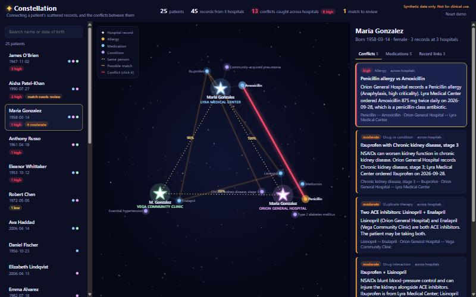
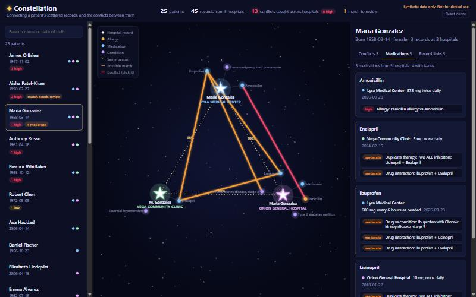
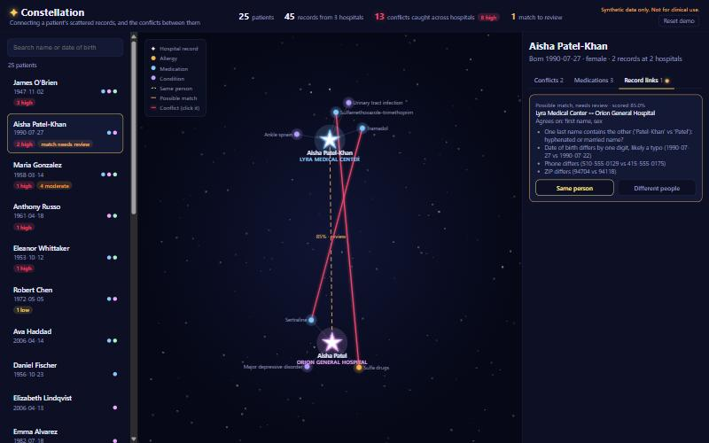

# ✦ Constellation

**Hospitals can already share patient records. Nobody connects the dots.**
Constellation gathers one patient's scattered records from different hospitals into a single
constellation, and flags the dangerous contradictions between them before they cause harm.

*Built at Hyphen-Hacks 2026 for the theme "Crafting Constellations".*
<!-- Team: add your names here before submitting. -->



> All patients and hospitals are made up. This is a hackathon prototype, not a medical device.

## The problem

When a patient is treated at several hospitals, each one keeps its own record. National networks
such as TEFCA, Epic's network and CommonWell can now send those records between hospitals, but
two problems remain:

1. **The same person looks different in each system.** "Jim OBrien" at one hospital is
   "James O'Brien" at another, with the birth date typed day-first. If the records aren't linked,
   nobody sees the full picture.
2. **Nobody cross-checks the pile.** One hospital records a penicillin allergy. Another hospital's
   ER, without seeing it, prescribes amoxicillin, which is a penicillin.

## What Constellation does

1. **Reads each hospital's records** in **FHIR R4**, the standard format hospitals use to exchange
   data.
2. **Works out which records belong to the same person**, even with nicknames, typos, swapped
   dates, married names or a move. Every link comes with a confidence score and a plain-English
   reason.
3. **Puts a human in charge of uncertain matches.** A link scored between 50% and 95% is flagged
   "needs review". A clinician clicks **Same person** or **Different people**, and the
   constellation re-forms. Every decision goes into a **tamper-evident audit trail**: who
   decided, when, and what the score was.
4. **Catches conflicts across the combined record:**
   - allergy vs drug
   - two drugs that do the same job
   - dangerous drug pairs
   - a drug that worsens a diagnosis
   - the same drug at different doses

   Each conflict says how serious it is and which hospital each side came from.
5. **Lists what the patient is actually taking:** every drug, every hospital that prescribed it,
   and its problems.

### Why "Constellation"?

Each hospital's record is a **star**, and the patient's allergies, medications and conditions
orbit it. **Gold lines** join records that are the same person. **Red glowing lines** join facts
that conflict. Every patient becomes a constellation, and the dangerous ones are easy to spot.

| Medications: what is this patient actually taking? | Human review of an uncertain match |
|---|---|
|  |  |

## How it works

```
Hospital FHIR bundles ──► Record matching ──► Conflict rules ──► Constellation graph ──► React + D3
  (Orion, Lyra, Vega)     (who is who?)       (what's wrong?)     (FastAPI JSON)         (the sky)
```

### Matching records to people

We use a **Fellegi–Sunter** style scorer, a standard method for linking records. It compares first
name, last name, birth date, sex, phone and ZIP. Each field adds evidence for or against a match,
and the total becomes a probability:

| Score | What happens |
|---|---|
| ≥ 95% | Linked automatically as the same person |
| 50–95% | Linked as a **possible match**, and a clinician decides |
| < 50% | Treated as different people |

It handles nicknames (Jim = James), initials (M. = Maria), punctuation (O'Brien = OBrien), married
and hyphenated names (Patel → Patel-Khan), misspellings (Jaro-Winkler similarity), and birth dates
with the day and month swapped or digits mistyped. Two different women named Maria Gonzalez stay
separate, because their birth dates and phone numbers disagree.

A conflict that depends on a link nobody has confirmed yet is labelled **unconfirmed**. We never
claim more certainty than we have.

### Scaling to a real hospital network

Comparing every record with every other doesn't scale: 100,000 records would take 5 billion
comparisons. Constellation uses **blocking**: two records are only compared if they share at
least one of these:
- the same birth date;
- the same phone number;
- a last name that sounds alike (Soundex) plus the same birth year.

Each of these survives a different kind of mistake, so a real match is missed only if all three
fail at once. Pair scores are cached, so a clinician's decision relinks patients without
re-scoring.

`python -m app.benchmark` generates synthetic patients with known answers and realistic
mistakes, then measures speed and accuracy:

| Records | Comparing every pair | With blocking | Time | Real links kept by blocking | Auto-linked: recall / precision |
|---|---|---|---|---|---|
| 20,000 | 200 million | 35,174 (**5,686× fewer**) | 2.5 s | 99.98% | 99.73% / 99.97% |
| 100,000 | 5 billion (est. 110 h) | 686,541 (**7,283× fewer**) | 58 s | 99.97% | 99.69% / 99.67% |

### An audit trail clinicians can trust

Every match decision is appended to a log and never edited or deleted. Undoing a decision, or
resetting the demo, adds a new entry. Each entry stores who decided, when, the matcher's score at
the time, and what the decision replaced.

The log is **hash-chained**: each entry includes the SHA-256 of the one before it. If someone
edits or deletes an earlier entry, the chain breaks. The app then shows a warning and **ignores
that entry and everything after it**, so a forged decision can never merge or split a patient's
records. Decisions are replayed from the log at startup, so they survive a restart.

### Catching conflicts

A small, hand-written knowledge base groups drugs into classes (penicillins, NSAIDs, blood
thinners, and so on) and lists the dangerous combinations. Each conflict is ranked **high**,
**moderate** or **low** and explained in plain English.

## Demo patients

| Patient | What it shows |
|---|---|
| **Maria Gonzalez** (1958) | Penicillin allergy at Orion; amoxicillin and ibuprofen from Lyra's ER; a second blood-pressure drug of the same class at Vega. Spelled three different ways. |
| **Maria Gonzalez** (1985) | A different woman with the same name, kept separate |
| **James O'Brien** (1947) | "Jim OBrien" and a day/month-swapped birth date. Two blood thinners plus an NSAID: 3 bleeding risks |
| **Aisha Patel / Patel-Khan** (1990) | Married name, moved, and a birth-date typo, so the match **needs review** |
| **Anthony "Tony" Russo** (1961) | Nitroglycerin from a heart clinic, sildenafil from urgent care: a dangerous drop in blood pressure |
| **Eleanor Whittaker / Whitaker** (1953) | Misspelled surname and transposed birth-date digits. Simvastatin plus clarithromycin risks muscle damage |
| **Robert "Bob" Chen** (1972) | Same statin, different dose at two hospitals |

18 more random patients make the matching realistic, and a test checks that they produce no false
alarms.

## Run it

You need Python 3.11+ and Node 20+.

```bash
# Backend (terminal 1)
cd backend
python -m venv .venv          # Windows: py -m venv .venv
source .venv/bin/activate     # Windows: .venv\Scripts\activate
pip install -r requirements.txt
uvicorn app.main:app --port 8000
```

```bash
# Frontend (terminal 2)
cd frontend
npm install
npm run dev
```

Open http://localhost:5173. Inside `backend/`, run the tests with `pytest` and the scaling
benchmark with `python -m app.benchmark --records 20000`.

## Built with

- **Backend:** Python, FastAPI, FHIR R4 (synthetic data), our own record-matching and conflict
  engine with no ML black box, and a hash-chained audit log
- **Frontend:** React, Vite, D3 force layout
- **Tests:** pytest

## Limitations and next steps

- **Drug rules:** the knowledge base is a small demo. A real product would use RxNorm drug codes
  and a licensed interaction database.
- **Faster scoring:** blocking removes thousands of times more work than it costs, but scoring
  the remaining pairs still runs on one CPU core. It splits easily across cores or machines, and
  new records could be matched as they arrive instead of all at once.
- **Privacy:** a real deployment would run inside the hospital network or through TEFCA, under
  HIPAA, rather than copying data around.
- **Audit log:** it's a local file with no logins, so "who" is the name a reviewer types in. A
  real system would tie entries to authenticated clinicians and keep a copy of the log elsewhere,
  because a hash chain alone can't detect entries cut off the end.
